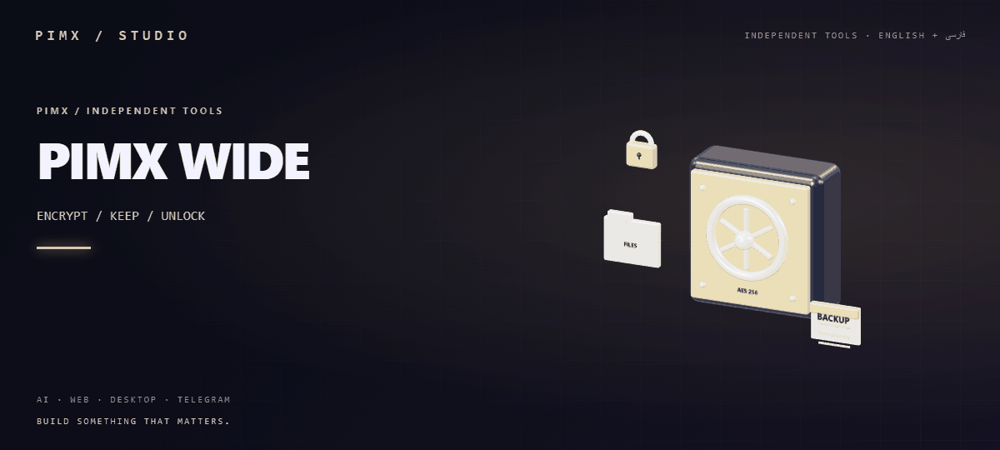
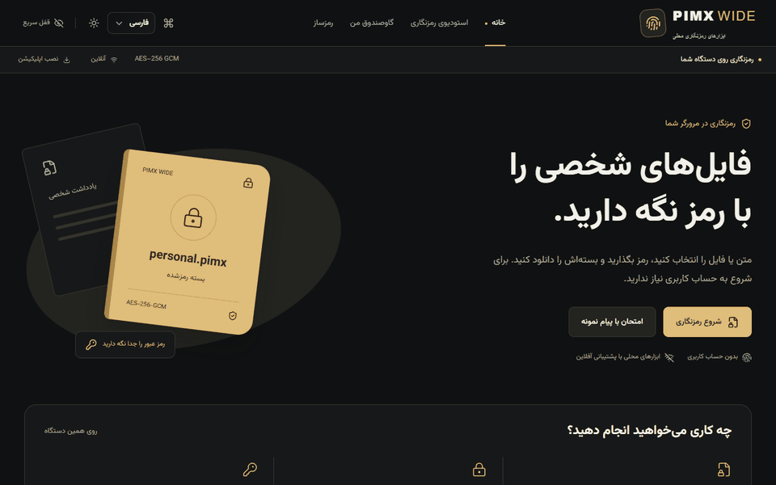

<div align="center">

<a href="https://pimxwide.pages.dev/"></a>

[English](README.md) · [فارسی](README.fa.md) · [Live website ↗](https://pimxwide.pages.dev/)

[](https://github.com/MOHAMMADREZAABEDINPOOR/PIMX_WIDE)

</div>

# PIMX WIDE

Encrypt messages, files and folders locally with AES-256-GCM. Organize encrypted packages in a password-protected vault, create passwords or passphrases, and keep encrypted backups; local tools work offline after caching.

<a href="https://pimxwide.pages.dev/"></a>

[Preview of the redesigned interface · PNG](assets/readme/redesign.png) · [Static artwork](assets/readme/hero.png)

## What you can do

- AES-256-GCM packages for text, files and folders; legacy package support
- Encrypted local vault with tags, favorites, backups and automatic locking
- Cryptographic passwords/passphrases, eight languages and offline local tools

Optional share links upload only the encrypted package and require Pages Functions with a D1 database. The current deployment has no D1 binding, so server links are unavailable. Passwords stay on the device; visit analytics are optional and disabled by default.

## Encryption and vault

- Text, file and folder encryption with AES-256-GCM. Version 2 derives keys using PBKDF2-SHA256 with 600,000 iterations; legacy packages remain readable.
- A local encrypted vault with titles, tags, favorites and encrypted backups. The vault password is separate from each package’s password.
- Random passwords and passphrases using browser cryptographic randomness. Passphrases use the EFF Long Wordlist; see [THIRD_PARTY.md](THIRD_PARTY.md).
- Portable packages, QR codes and optional share links. Link limits stop server delivery; they cannot remove copies already downloaded.
- Quick lock, automatic locking after inactivity, keyboard navigation and support for reduced motion.

## Getting started

Use Node.js 22.12 or later.

```bash
git clone https://github.com/MOHAMMADREZAABEDINPOOR/PIMX_WIDE.git
cd PIMX_WIDE
npm ci
npm run dev
```

The Vite server provides local encryption, the vault and password generation. To test share links and administrator analytics, run the Cloudflare Pages server:

```bash
npm run db:local
npm run dev:full
```

Open `http://localhost:8788`. See [SETUP.md](SETUP.md) for administrator credentials, database bindings and Cloudflare deployment.

## Configuration and deployment

The backend uses the `PIMX_DB` D1 binding in [wrangler.toml](wrangler.toml). Administrator access requires `ADMIN_PASSWORD_HASH` and `SESSION_SECRET`. Generate them with `npm run admin:secret`, keeping the password out of command arguments. Store the output in an ignored `.dev.vars` file locally, or encrypted secrets in Cloudflare Pages.

Run `npm run build` and deploy `dist` with `functions/` and the configured D1 database. A static frontend alone supports device-local tools; share links and administrator analytics need Pages Functions. Production requires HTTPS.

## Commands and checks

| Command | Purpose |
|---|---|
| `npm run dev` | Start the frontend development server |
| `npm run build` | Check TypeScript and build the production app with its offline shell |
| `npm run preview` | Preview the production frontend |
| `npm run typecheck` | Check TypeScript |
| `npm test` | Test encryption, passwords and administrator sessions |
| `npm run test:e2e` | Run browser tests with a disposable local Pages server and database |

Browser tests require Playwright Chromium: `npx playwright install chromium`.

## Project structure

| Path | Contents |
|---|---|
| [pages/](pages/) | Application pages |
| [components/](components/) | Shared controls, visualizations and styles |
| [contexts/](contexts/) | Preferences and vault session state |
| [services/](services/) | Encryption, downloads and local vault storage |
| [functions/](functions/) | Cloudflare API routes |
| [migrations/](migrations/) | D1 database schema |
| [tests/](tests/) | Unit and browser tests |
| [public/](public/) | Icons, illustrations and app manifest |
| [assets/](assets/) | Documentation artwork |

## Limits and data handling

Keep passwords separately from packages and try decrypting a package before deleting the original. There is no password recovery. Clearing browser storage can remove the vault and preferences; keep an encrypted backup elsewhere.

Studio packages accept up to 100 files and 48 MB of input on desktop, or 24 MB on mobile. Share links accept encrypted packages up to 500 KB. Quick lock clears application session state and closes the vault, but cannot guarantee browser-memory or clipboard erasure. Downloaded files remain on the device.

This project has not had an independent security audit. Read [SETUP.md](SETUP.md) for protocol details and storage limits.

## Troubleshooting

- Missing dependencies: run `npm ci`.
- Share links or admin requests fail: check the Pages Functions server, D1 binding and administrator secrets.
- Offline tools are unavailable: load the production app fully online first. Development mode does not register the service worker.
- Old assets appear: rebuild and refresh the browser cache.

## Contributing

Create a focused branch, check the affected behavior and explain the change. Keep private data, build outputs and local databases out of commits.

## License

No repository-level license file is included. Contact the repository owner for reuse terms.

[GitHub](https://github.com/MOHAMMADREZAABEDINPOOR/PIMX_WIDE) · [PIMX](https://github.com/MOHAMMADREZAABEDINPOOR) · [Portfolio](https://pimx.pages.dev/)
